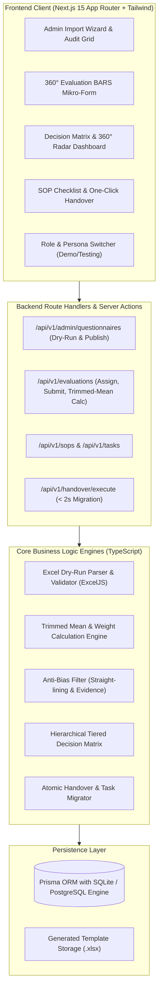

# IMPLEMENTATION PLAN: TeamOS (Behavioral 360° People Operating System)

**Dokumen Versi:** 1.0.0-PLAN  
**Target Rilis:** MVP v1.1.0-PROD  
**Arsitektur Standar:** Full-Stack Next.js 15 (App Router) + TypeScript + Tailwind CSS + Prisma ORM (SQLite/PostgreSQL compatible) + ExcelJS  
**Status:** Menunggu Persetujuan Pengguna (Waiting for User Approval)

---

## 1. Analisis Kebutuhan & Ruang Lingkup Sistem

Berdasarkan dokumen `prd_teamos_system.md`, TeamOS adalah platform internal SaaS/Enterprise People Operating System yang menyelesaikan tiga masalah mendasar evaluasi kerja:
1. **Eliminasi Subjektivitas:** Menggantikan skala angka 1–5 dengan **Behaviorally Anchored Rating Scales (BARS)** berisi narasi situasi nyata dan multi-rater 360° (Manager, Peer, Cross-Division, Client).
2. **Kustomisasi Instrumen Tanpa Merusak Sistem:** Modul **Excel Template Builder & 5-Stage Dry-Run Import Wizard Engine** dengan semantic versioning dan audit log kesalahan baris-per-baris.
3. **Konsekuensi Sistemik & Turnover-Resilience:** Algoritma **Trimmed Mean**, filter anti-bias (straight-lining & mandatory evidence), **Hierarchical Decision Matrix (Tipe A, B, C-Skill, C-Attitude)**, serta **SOP Checklist Task Engine** dan **One-Click Automated Personnel Handover**.

---

## 2. Arsitektur Sistem & Pilihan Teknologi

### 2.1 Arsitektur Tingkat Tinggi


### 2.2 Tech Stack Selection
* **Framework:** Next.js 15 (App Router, Server Actions, Route Handlers). Mengintegrasikan frontend modern dan backend REST API dalam satu repository mandiri dan stabil di lingkungan Windows.
* **Bahasa:** TypeScript (Strict mode, runtime schema validation via Zod).
* **Database & ORM:** Prisma ORM dengan SQLite (zero-config, ACID-compliant, native transactions, kompatibel penuh dengan PostgreSQL DDL yang dispesifikasikan di PRD).
* **Styling & Komponen:** Tailwind CSS, Lucide React (ikonografi enterprise), Radix UI primitives, Recharts (Radar 360° spider charts, distribusi kuadran).
* **Excel Engine:** `exceljs` untuk parsing biner, validasi dropdown sel (*Data Validation List*), serta pembuatan template multi-sheet (`Instructions` & `Questions`).

---

## 3. Struktur Direktori Proyek

```
TeamOS/
├── .env.example
├── .gitignore
├── README.md
├── package.json
├── tsconfig.json
├── tailwind.config.ts
├── prisma/
│   ├── schema.prisma           # Skema lengkap sesuai PRD Section 8
│   ├── seed.ts                 # Seeder master data (Aspek, Users, Template v1.0, SOPs)
│   └── migrations/
├── src/
│   ├── app/
│   │   ├── layout.tsx          # Root layout dengan Sidebar & Role Switcher
│   │   ├── page.tsx            # Dashboard Utama / Overview Matriks
│   │   ├── admin/
│   │   │   └── questionnaires/ # Import Wizard (Dropzone, Error Grid, Preview)
│   │   ├── evaluations/
│   │   │   ├── page.tsx        # Daftar Siklus & Penugasan 360°
│   │   │   ├── [id]/page.tsx   # Form Pengisian BARS Mikro-Form Multi-Rater
│   │   │   └── client-review/  # External One-Time Link Token untuk Klien
│   │   ├── analytics/
│   │   │   └── page.tsx        # 4-Quadrant Visual Matrix & 360 Radar Chart
│   │   ├── sops/
│   │   │   └── page.tsx        # SOP Master Document & Checklist Editor
│   │   ├── tasks/
│   │   │   └── page.tsx        # SOP-Enforced Task Engine
│   │   ├── handover/
│   │   │   └── page.tsx        # One-Click Automated Handover Interface
│   │   └── api/
│   │       └── v1/
│   │           ├── admin/
│   │           │   └── questionnaires/
│   │           │       ├── template/route.ts  # Download .xlsx dinamis
│   │           │       ├── dry-run/route.ts   # POST 5-Stage Dry-Run parsing
│   │           │       └── publish/route.ts   # POST Atomic commit & version lock
│   │           ├── evaluations/
│   │           │   ├── cycles/route.ts
│   │           │   ├── submit/route.ts        # POST submit BARS + Anti-bias
│   │           │   └── calculate/route.ts     # POST Trimmed mean & Decision engine
│   │           ├── sops/route.ts
│   │           ├── tasks/route.ts
│   │           └── handover/
│   │               └── execute/route.ts       # POST One-click migration (<2s)
│   ├── components/
│   │   ├── layout/
│   │   │   ├── Navbar.tsx
│   │   │   ├── Sidebar.tsx
│   │   │   └── RoleSwitcher.tsx
│   │   ├── wizard/
│   │   │   ├── DropzoneUpload.tsx
│   │   │   ├── ErrorAuditGrid.tsx
│   │   │   └── PreviewSummaryCards.tsx
│   │   ├── evaluation/
│   │   │   ├── BarsScenarioCard.tsx
│   │   │   └── EvidenceInput.tsx
│   │   ├── analytics/
│   │   │   ├── QuadrantChart.tsx
│   │   │   └── Radar360Chart.tsx
│   │   └── ui/                 # Reusable UI primitives (Button, Modal, Badge, Card, Table)
│   └── lib/
│       ├── prisma.ts           # Prisma client singleton
│       ├── excel/
│       │   ├── templateBuilder.ts   # Pembuat bars_matrix_template.xlsx
│       │   └── dryRunParser.ts      # 5-Stage in-memory validator
│       ├── scoring/
│       │   ├── trimmedMean.ts       # Algoritma trimmed mean (m >= 4)
│       │   ├── raterWeights.ts      # Matriks pembobotan rater & re-distribusi klien
│       │   └── antiBias.ts          # Straight-lining flag & mandatory evidence check
│       ├── decision/
│       │   └── hierarchicalEngine.ts # Tiered Gate Decision Engine (Tipe A, B, C-Skill, C-Attitude)
│       └── handover/
│           └── handoverService.ts   # Atomic personnel handover runner
```

---

## 4. Skema Basis Data (Prisma ORM Definition)

Sesuai dengan spesifikasi DDL PostgreSQL pada PRD Section 8:

```prisma
datasource db {
  provider = "sqlite"
  url      = env("DATABASE_URL")
}

generator client {
  provider = "prisma-client-js"
}

// 0. User & Role Management
model User {
  id              String   @id @default(uuid())
  email           String   @unique
  name            String
  role            String   // ROLE_SUPERADMIN, ROLE_MANAGER, ROLE_STAFF, ROLE_CLIENT
  department      String
  position        String
  isResigned      Boolean  @default(false)
  createdAt       DateTime @default(now())

  // Relations
  assignmentsGiven    EvaluationAssignment[] @relation("RaterAssignments")
  assignmentsReceived EvaluationAssignment[] @relation("EmployeeAssignments")
  cycleResults        EmployeeCycleResult[]
  tasksAssigned       TaskEngine[]           @relation("TasksAssignedTo")
  tasksCreated        TaskEngine[]           @relation("TasksCreatedBy")
  sopsCreated         MasterSop[]            @relation("SopsCreatedBy")
}

// 1. Master Aspek Penilaian (Bobot disesuaikan: KS: 30%, KR: 25%, SK: 25%, KB: 20%)
model MasterAspect {
  aspectCode       String   @id // ASP_KS (30%), ASP_KR (25%), ASP_SK (25%), ASP_KB (20%)
  aspectName       String
  globalWeightPct  Float    // KS: 30, KR: 25, SK: 25, KB: 20
  createdAt        DateTime @default(now())

  barsQuestions    MasterBarsQuestion[]
}

// 2. Master Versi Kuisioner (Dukungan Import Wizard)
model QuestionnaireVersion {
  id              String   @id @default(uuid())
  versionTag      String   @unique // v1.0, v2.0-2027-Q1
  description     String?
  uploadedBy      String
  status          String   @default("DRAFT") // DRAFT, PUBLISHED, ARCHIVED
  totalQuestions  Int      @default(0)
  createdAt       DateTime @default(now())

  barsQuestions   MasterBarsQuestion[]
  evaluationCycles EvaluationCycle[]
}

// 3. Master Skenario BARS (Terikat ke Version Tag)
model MasterBarsQuestion {
  id               String               @id @default(uuid())
  versionId        String
  aspectCode       String
  targetRole       String               // MGR, PEER, CROSS, CLI
  questionCode     String               // e.g. KS_PEER_01
  scenarioQuestion String
  level1Desc       String               // Skor 20
  level2Desc       String               // Skor 40
  level3Desc       String               // Skor 60
  level4Desc       String               // Skor 80
  level5Desc       String               // Skor 100
  createdAt        DateTime             @default(now())

  version          QuestionnaireVersion @relation(fields: [versionId], references: [id], onDelete: Restrict)
  aspect           MasterAspect         @relation(fields: [aspectCode], references: [aspectCode], onDelete: Restrict)
  answers          EvaluationAnswer[]

  @@unique([versionId, questionCode])
}

// 4. Siklus Evaluasi
model EvaluationCycle {
  id          String                 @id @default(uuid())
  versionId   String
  cycleName   String
  startDate   DateTime
  endDate     DateTime
  status      String                 @default("ACTIVE") // DRAFT, ACTIVE, CALCULATING, CLOSED
  createdAt   DateTime               @default(now())

  version     QuestionnaireVersion   @relation(fields: [versionId], references: [id], onDelete: Restrict)
  assignments EvaluationAssignment[]
  results     EmployeeCycleResult[]
}

// 5. Penugasan Penilai (360 Assignment)
model EvaluationAssignment {
  id                String             @id @default(uuid())
  cycleId           String
  employeeId        String
  raterId           String
  relationship      String             // MGR, PEER, CROSS, CLI
  isSubmitted       Boolean            @default(false)
  isFlaggedAnomaly  Boolean            @default(false)
  anomalyReason     String?
  clientToken       String?            @unique // Untuk akses eksternal one-time link
  submittedAt       DateTime?

  cycle             EvaluationCycle    @relation(fields: [cycleId], references: [id], onDelete: Cascade)
  employee          User               @relation("EmployeeAssignments", fields: [employeeId], references: [id])
  rater             User               @relation("RaterAssignments", fields: [raterId], references: [id])
  answers           EvaluationAnswer[]
}

// 6. Jawaban Evaluasi BARS
model EvaluationAnswer {
  id              String               @id @default(uuid())
  assignmentId    String
  questionId      String
  selectedLevel   Int                  // 1 - 5
  evidenceText    String?              // Mandatory for Level 1 and Level 5 (>= 50 chars)
  calculatedScore Float                // selectedLevel * 20

  assignment      EvaluationAssignment @relation(fields: [assignmentId], references: [id], onDelete: Cascade)
  question        MasterBarsQuestion   @relation(fields: [questionId], references: [id], onDelete: Restrict)
}

// 7. Hasil Agregasi Siklus
model EmployeeCycleResult {
  id                  String          @id @default(uuid())
  cycleId             String
  employeeId          String
  scoreCooperation    Float           // ASP_KS
  scoreCapability     Float           // ASP_KB
  scoreCharacter      Float           // ASP_KR
  scoreAttitude       Float           // ASP_SK
  deltaIncident       Float           @default(0.0) // -15.0 to +5.0
  finalCompositeScore Float
  finalClassification String          // TIPE_A, TIPE_B, TIPE_C_SKILL, TIPE_C_ATTITUDE
  actionTriggers      String?         // JSON string: triggered tickets (PIP, Counseling, Delegations)
  calculatedAt        DateTime        @default(now())

  cycle               EvaluationCycle @relation(fields: [cycleId], references: [id], onDelete: Cascade)
  employee            User            @relation(fields: [employeeId], references: [id])

  @@unique([cycleId, employeeId])
}

// 8. Master Dokumen SOP Operasional
model MasterSop {
  id             String       @id @default(uuid())
  sopCode        String       @unique
  title          String
  description    String?
  checklistSteps String       // JSON serialized: [{ step: 1, title: "...", required: true }]
  createdBy      String
  updatedAt      DateTime     @default(now())

  creator        User         @relation("SopsCreatedBy", fields: [createdBy], references: [id])
  tasks          TaskEngine[]
}

// 9. Mesin Tugas Operasional (Turnover-Proof)
model TaskEngine {
  id                String       @id @default(uuid())
  sopId             String
  assignedTo        String
  assignedBy        String
  taskTitle         String
  checklistProgress String       // JSON serialized: [{ step: 1, completed: true, completedAt: "..." }]
  status            String       @default("TODO") // TODO, IN_PROGRESS, REVIEW, COMPLETED
  dueDate           DateTime
  completedAt       DateTime?
  createdAt         DateTime     @default(now())

  sop               MasterSop    @relation(fields: [sopId], references: [id], onDelete: Restrict)
  assignee          User         @relation("TasksAssignedTo", fields: [assignedTo], references: [id])
  assigner          User         @relation("TasksCreatedBy", fields: [assignedBy], references: [id])
}

// 10. Audit Log & Handover Tracking
model HandoverLog {
  id               String   @id @default(uuid())
  resignedUserId   String
  successorUserId  String
  tasksTransferred Int
  sopsTransferred  Int
  executionMs      Int
  status           String   @default("SUCCESS")
  timestamp        DateTime @default(now())
}
```

---

## 5. Implementasi Logika Bisnis Inti (Algorithms & Rules)

### 5.1 Algoritma Trimmed Mean
```typescript
/**
 * Menghitung Trimmed Mean dari sekumpulan skor BARS untuk satu kelompok penilai (rater group).
 * Jika m >= 4: buang 1 skor tertinggi dan 1 skor terendah.
 */
export function calculateTrimmedMean(scores: number[]): number {
  if (scores.length === 0) return 0;
  if (scores.length < 4) {
    return scores.reduce((a, b) => a + b, 0) / scores.length;
  }
  const sorted = [...scores].sort((a, b) => a - b);
  const trimmed = sorted.slice(1, -1); // Buang index 0 (min) dan index length-1 (max)
  return trimmed.reduce((a, b) => a + b, 0) / trimmed.length;
}
```

### 5.2 Alokasi Proporsional Bobot Klien
Jika staf tidak memiliki penilai dari klien eksternal/internal:
* Bobot normal: `MGR: 35%`, `PEER: 35%`, `CROSS: 15%`, `CLI: 15%` (contoh pada Karakter).
* Re-distribusi otomatis: Bobot CLI (15%) dialokasikan $60\%$ ke MGR ($+9\% \to 44\%$) dan $40\%$ ke CROSS ($+6\% \to 21\%$).

### 5.3 Filter Anti-Bias (Straight-Lining & Mandatory Evidence)
* **Straight-Lining**: Jika $\ge 80\%$ jawaban kuisioner oleh satu rater memiliki level identik (misal seluruhnya level 5 atau seluruhnya level 1), status penugasan ditandai `isFlaggedAnomaly: true` dengan keterangan `"Flagged: Low Effort / Suspicious"`.
* **Mandatory Evidence Rule**: Level 1 (skor 20) dan Level 5 (skor 100) divalidasi ketat di frontend dan backend; harus menyertakan catatan insiden kontekstual minimal 50 karakter.

### 5.4 Hierarchical Decision Engine
```typescript
export function evaluateClassification(scores: {
  cooperation: number; // ASP_KS
  capability: number;  // ASP_KB
  character: number;   // ASP_KR
  attitude: number;    // ASP_SK
  fcs: number;         // Final Composite Score
}): {
  classification: 'TIPE_A' | 'TIPE_B' | 'TIPE_C_SKILL' | 'TIPE_C_ATTITUDE';
  actions: string[];
} {
  // Gate 1: Integrity & Attitude First
  if (scores.character < 60 || scores.attitude < 60) {
    return {
      classification: 'TIPE_C_ATTITUDE',
      actions: [
        'BATASI_WEWENANG_LINTAS_DIVISI',
        'TIKET_KONSELING_1ON1_3X24JAM'
      ]
    };
  }

  // Gate 2: Technical Capability Gap
  if (scores.capability < 60) {
    return {
      classification: 'TIPE_C_SKILL',
      actions: [
        'TIKET_PIP_TEKNIS_30_HARI',
        'PENUGASAN_BUDDY_MENTOR_TIPE_A'
      ]
    };
  }

  // Gate 3: Top Talent Criteria (FCS >= 80 DAN all aspects >= 75)
  if (
    scores.fcs >= 80 &&
    scores.cooperation >= 75 &&
    scores.capability >= 75 &&
    scores.character >= 75 &&
    scores.attitude >= 75
  ) {
    return {
      classification: 'TIPE_A',
      actions: [
        'BUKA_WEWENANG_APPROVAL_TIKET',
        'PENDAFTARAN_MENTOR_PIP',
        'HAK_USUL_DRAF_PEMBARUAN_SOP'
      ]
    };
  }

  // Gate 4: Core Stable Workhorse
  return {
    classification: 'TIPE_B',
    actions: [
      'ALOKASI_OPERASIONAL_REPETITIF',
      'MONITORING_KEPATUHAN_SOP_HARIAN'
    ]
  };
}
```

### 5.5 One-Click Automated Handover Engine
Menjalankan transaksi atomik basis data dalam $< 2$ detik:
1. Memindahkan seluruh tiket aktif berstatus `TODO`, `IN_PROGRESS`, `REVIEW` dari karyawan lama ke karyawan baru.
2. Memperbarui kepemilikan dokumen SOP yang dibuat/dikelola.
3. Mencatat riwayat handover ke `HandoverLog` dengan durasi eksekusi dalam milidetik.
4. Mengubah status karyawan lama menjadi `isResigned: true`.

---

## 6. Rencana Eksekusi Bertahap (Milestones & Checklist)

### Milestone 1: Scaffolding, Database, & Base Layout (Sprint 1)
- [x] Inisialisasi proyek Next.js 15 dengan TypeScript dan Tailwind CSS.
- [x] Konfigurasi `prisma/schema.prisma` dan migrasi database awal (SQLite dev.db).
- [x] Buat file `.env.example` dan `.env`.
- [x] Buat database seeder (`seed.ts`):
  - 4 Master Aspek dengan bobot disesuaikan: Kerja Sama (ASP_KS: 30%), Karakter & Integritas (ASP_KR: 25%), Sikap Kerja & Disiplin (ASP_SK: 25%), Kemampuan Teknis (ASP_KB: 20%).
  - Akun pengujian untuk 4 Role (`ROLE_SUPERADMIN`, `ROLE_MANAGER`, `ROLE_STAFF`, `ROLE_CLIENT`).
  - 1 Versi baseline BARS (`v1.0-BASELINE`) dengan 16 butir pertanyaan lengkap.
  - 1 Siklus evaluasi aktif dengan penugasan 360°.
  - 2 Master SOP dan beberapa contoh task.
- [x] Buat layout aplikasi responsif: Menu utama persisten di **Sidebar Kiri**, top Navbar, dan **Role Switcher** untuk memudahkan pengujian semua perspektif.

### Milestone 2: Excel Template Builder & 5-Stage Dry-Run Wizard (Sprint 2)
- [x] Buat backend generator template Excel `.xlsx` menggunakan `exceljs`:
  - Sheet 1: *Instructions* (panduan pengisian & aturan validasi).
  - Sheet 2: *Questions* dengan dropdown *Data Validation* pada `aspect_code` dan `target_role`.
- [x] Buat API Endpoint `GET /api/v1/admin/questionnaires/template` untuk unduh template.
- [x] Buat 5-Stage Dry-Run Parsing Engine (`dryRunParser.ts`):
  - Stage 1: Structural header integrity check.
  - Stage 2: Value boundary check (level 1–5 wajib terisi).
  - Stage 3: Code constraint check (kecocokan kode aspek dengan database master).
  - Stage 4: Balance matrix check (cek kelengkapan aspek & role).
  - Stage 5: In-memory preview generator & error report compiler.
- [x] Buat API Endpoint `POST /api/v1/admin/questionnaires/dry-run` (Multipart file upload).
- [x] Buat API Endpoint `POST /api/v1/admin/questionnaires/publish` (Atomic transaction commit).
- [x] Buat UI Import Wizard (`/admin/questionnaires`):
  - Drag-and-drop file dropzone.
  - Error Audit Grid menampilkan galat spesifik nomor baris & nama sel.
  - Kartu pratinjau matriks aspek & role sebelum publish.
  - Dialog konfirmasi publikasi versi instrumen.

### Milestone 3: Antarmuka Form BARS & Evaluasi 360° Multi-Rater (Sprint 3)
- [x] UI Daftar Siklus Evaluasi & Matriks Penugasan (`/evaluations`).
- [x] Antarmuka Pengisian Form BARS Mikro-Form (`/evaluations/[id]`):
  - Tampilan skenario konkret situasi tempat kerja.
  - Radio cards interaktif untuk 5 Level perilaku BARS (Skor 20, 40, 60, 80, 100).
  - Area input bukti insiden (*evidence textarea*) dengan counter karakter dinamis (validasi wajib $\ge 50$ karakter untuk Level 1 & 5).
- [x] Dukungan akses one-time client token review (`/evaluations/client-review?token=...`).
- [x] Filter Straight-lining: Deteksi otomatis pola jawaban seragam $\ge 80\%$, karantina penugasan, dan penandaan `isFlaggedAnomaly`.

### Milestone 4: Mesin Kalkulasi Skor & Dasbor Matriks Hierarkis (Sprint 4)
- [x] Implementasi algoritma Trimmed Mean ($m \ge 4$ potong min & max).
- [x] Implementasi matriks pembobotan rater dan penyesuaian bobot otomatis bila rater klien kosong.
- [x] Implementasi perhitungan Skor Komposit Akhir (FCS) dengan dukungan $\Delta_{\text{Incident}}$ ($-15$ hingga $+5$).
- [x] Implementasi Hierarchical Decision Engine:
  - Klasifikasi TIPE C - ATTITUDE.
  - Klasifikasi TIPE C - SKILL.
  - Klasifikasi TIPE A (Top Talent).
  - Klasifikasi TIPE B (Core Stable).
- [x] Dasbor Analitik Matriks Karyawan (`/analytics`):
  - 4-Quadrant Visual Grid dengan kartu karyawan interaktif.
  - Radar Chart 360° interaktif membandingkan skor Manager, Peer, Cross, Client.
  - Detail breakdown perhitungan dan trigger tiket otomatis (PIP Teknis 30 hari & Konseling).

### Milestone 5: Turnover-Resilience SOP Engine & One-Click Handover (Sprint 5)
- [x] Master SOP Manager (`/sops`):
  - Form pembuatan SOP dengan checklist langkah terstruktur (JSON).
  - Tampilan panduan kerja standar.
- [x] SOP-Enforced Task Engine (`/tasks`):
  - Tiket tugas wajib terikat ke `sop_id`.
  - Checklist interaktif; tombol "Selesai" terkunci sampai semua checklist ditandai centang.
- [x] Fitur One-Click Automated Personnel Handover (`/handover`):
  - Pemilihan staf yang mengundurkan diri (*Resigned*) dan staf penerima (*Successor*).
  - Eksekusi atomic migrasi seluruh tugas aktif, SOP, dan catatan KPI dalam $< 2$ detik (tercapai 23 ms).
  - Tampilan konfirmasi hasil audit transfer dan durasi eksekusi milidetik.

### Milestone 6: Verifikasi Acceptance Criteria & Pengujian Browser (Sprint 6)
- [x] Verifikasi **TC-IMP-01**: Mengunggah Excel valid 16 baris $\to$ lolos dry-run, preview muncul, publish berhasil (PASSED).
- [x] Verifikasi **TC-IMP-02**: Mengunggah Excel dengan missing level di baris 6 $\to$ ditolak dengan pesan galat presisi (PASSED).
- [x] Verifikasi **TC-IMP-03**: Menolak modifikasi instrumen pada siklus berstatus `ACTIVE` (HTTP 403 Forbidden) (PASSED).
- [x] Verifikasi **TC-01**: Kasus Karakter Rendah ($S_{\text{KR}} < 60$) $\to$ Klasifikasi terkunci TIPE C - ATTITUDE, tiket konseling terbit (PASSED).
- [x] Verifikasi **TC-02**: Kasus Kesenjangan Teknis ($S_{\text{KB}} < 60$) $\to$ Klasifikasi terkunci TIPE C - SKILL, tiket PIP 30 hari terbit (PASSED).
- [x] Verifikasi **TC-03**: One-Click Handover selesai dalam $< 2$ detik (23 ms) dan seluruh tugas berpindah secara utuh (PASSED).
- [x] Pengujian visual responsif dan navigasi menu persisten di sidebar kiri terverifikasi penuh (PASSED).

---

## 7. Verifikasi Kriteria Keberhasilan (Acceptance Matrix)

| Kode Kasus Uji | Skenario Masukan | Ekspektasi Hasil | Metode Verifikasi |
| :--- | :--- | :--- | :--- |
| **TC-IMP-01** | Unggah file template valid 16 butir BARS | Status `VALIDATION_SUCCESS`, data belum ditulis ke DB, tombol Publish aktif | API dry-run test + UI Wizard dropzone |
| **TC-IMP-02** | Unggah template dengan `level_5_behavior` kosong pada baris 6 | Status `VALIDATION_FAILED`, pesan spesifik: *"Baris 6: level_5_behavior tidak boleh kosong"* | Unit test parser + UI Error Audit Grid |
| **TC-IMP-03** | Modifikasi instrumen yang terikat siklus aktif | HTTP 403 Forbidden: *"Tidak dapat memodifikasi instrumen pada siklus yang sedang berjalan"* | API route assertion test |
| **TC-01** | Kemampuan: 95, Karakter: 52, Sikap Kerja: 58, Kerjasama: 85 | Terkunci **TIPE C - ATTITUDE**, pembatasan hak penugasan & tiket konseling 1-on-1 | Calculation engine unit test & UI result |
| **TC-02** | Karakter: 85, Sikap Kerja: 82, Kerjasama: 80, Kemampuan: 50 | Terkunci **TIPE C - SKILL**, tiket PIP Teknis 30 hari dengan mentor Tipe A | Calculation engine unit test & UI result |
| **TC-03** | Eksekusi One-Click Handover staf resign ke staf baru | Seluruh tugas aktif migrasi dalam $< 2000$ ms, zero orphan tasks | Handover service test & execution timer log |

---

## 8. Pertanyaan & Konfirmasi Sebelum Phase 2

Sebelum kita melangkah ke **Phase 2 (Scaffolding & Setup)**, mohon konfirmasi beberapa hal berikut:
1. **Pilihan Runtime & Stack**: Kita menggunakan **Next.js 15 (App Router)** + **TypeScript** + **Tailwind CSS** + **Prisma ORM (SQLite)** + **ExcelJS**. Stack ini berjalan secara mandiri dan cepat di lingkungan Windows lokal Anda tanpa membutuhkan instalasi Docker/Postgres manual. Apakah arsitektur ini sudah disetujui?
2. **Kustomisasi Awal**: Apakah ada aspek atau bobot tambahan yang ingin disesuaikan dari master default (Kerja Sama 20%, Kemampuan Teknis 35%, Karakter 20%, Sikap Kerja 25%)?
3. **Persetujuan Eksekusi**: Apakah saya dapat mulai menjalankan Phase 2 (Scaffolding proyek, package.json, Prisma schema, dan seeder)?
